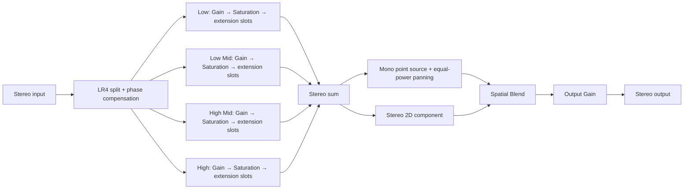

# Spatializer 4-band 기반 설계 및 구현

작성일: 2026-10-28

## 적용 상태

- `Demo Spatializer` 내부에 4-band DSP 경로를 추가했다.
- 기본값은 **4-band 비활성화**, 각 대역 Gain 1, Saturation Wet 0이다.
- `SpatializerBands`를 AudioSource에 추가하고 `Enable Four Band Processing`을 켜면 대역별 설정을 사용할 수 있다.
- 기존 `SpatializerGain`의 파라미터 인덱스 3과 씬의 출력 Gain 설정은 유지한다.
- 위치 변경에 대한 Pan / Spatial Blend / 출력 Gain 보간은 기본 5ms로 적용된다. `Motion Smoothing Ms`를 0으로 설정하면 즉시 변경 동작을 비교할 수 있다.
- Windows x64 Release DLL을 빌드해 `Assets/Plugins/x86_64/AudioPluginDemo.dll`에 반영했다.

## 신호 경로



4-band가 비활성화되면 분리기와 Effect 처리 연산을 건너뛰어 기존 입력을 그대로 panning 단계에 전달한다. 활성화 시 대역 Effect는 panning 이전의 stereo 신호에 적용되므로 Spatial Blend가 0인 2D 성분에도 반영된다. 2D 성분과 panning 성분이 같은 처리 신호에서 출발해, 중간 Spatial Blend에서 원본과 크로스오버 위상이 불필요하게 섞이는 것을 피한다.

## 대역 분리와 위상 보상

| 대역 | 기본 범위 | 독립 설정 |
| --- | --- | --- |
| Low | 0–250Hz | Gain, Saturation Drive / Wet, Effect 체인 |
| Low Mid | 250–2,000Hz | 동일 |
| High Mid | 2,000–6,000Hz | 동일 |
| High | 6,000Hz–Nyquist | 동일 |

경계는 이상적인 벽돌 필터가 아니라 24dB/oct의 전이 구간을 갖는다. 경계별로 Butterworth 2차 LP / HP를 각각 두 번 통과시키는 Linkwitz–Riley 4차를 사용했다. LR4의 구성과 합산 위상 특성은 [Linkwitz Lab의 Active Filters](https://www.linkwitzlab.com/filters.htm) 및 [Crossovers](https://www.linkwitzlab.com/crossovers.htm)를 참고했다.

구현은 가운데 경계 `f2`에서 먼저 나눈 뒤 아래쪽을 `f1`, 위쪽을 `f3`에서 분리하는 트리다. 아래쪽 부모 신호에 `f3`의 2차 allpass를, 위쪽 부모 신호에 `f1`의 2차 allpass를 적용한다.

`Li`, `Hi`를 경계 i의 LR4 저역 / 고역 전달함수, `Ai = Li + Hi`를 그 합인 allpass로 두면:

```text
B0 = L1 · A3 · L2
B1 = H1 · A3 · L2
B2 = L3 · A1 · H2
B3 = H3 · A1 · H2

B0 + B1 + B2 + B3
  = A1 · A3 · (L2 + H2)
  = A1 · A2 · A3
```

따라서 대역 Effect가 중립일 때 합산 진폭은 평탄하다. IIR allpass의 주파수별 위상 회전은 남으며 원본 파형과 sample 단위로 일치하는 linear-phase / perfect reconstruction 필터뱅크는 아니다.

필터 계수와 상태는 double로 계산하고 대역 출력은 float로 전달한다. 좌우 채널과 각 AudioSource는 필터 이력을 공유하지 않는다. 경계는 `20Hz ≤ f1 < f2 < f3 ≤ min(20kHz, 0.45 × sampleRate)`로 보정하며 최소 1Hz 간격을 둔다.

## Effect 확장 지점

`NativeCode/SpatializerDSP.h`에서 다음 책임을 분리했다.

| 구성 요소 | 책임 |
| --- | --- |
| `FourBandSplitter` | stereo → 4개 stereo 대역, 필터 상태 및 위상 보상 |
| `BandEffectChain` | 등록 순서대로 대역별 callback 실행 |
| `BandProcessor` | 기본 Gain → Saturation 순서와 각 파라미터 보간 |
| `FourBandProcessor` | 대역 분리, 개별 체인 처리, 합산, 활성화 전환 |
| `MotionInterpolator` | 위치 이력과 실제 렌더링한 공간 제어값의 연속성 유지 |

각 체인의 최대 슬롯 수는 4이며 기본 Effect가 2개를 사용한다. 새 native Effect는 source가 소유하는 상태를 만들고, 인스턴스 생성 시 해당 대역 체인의 `Add(state, process, reset)`에 등록한다.

```cpp
// EffectData의 멤버로 myLowEffect 상태를 소유한다고 가정.
effectdata->multiband.bands[0].chain.Add(
    &effectdata->myLowEffect,
    MyLowEffectProcess,
    MyLowEffectReset);

// 처리 콜백의 함수 형식:
// void MyLowEffectProcess(void* state, StereoFrame& frame, const BandContext& context);
// 초기화 콜백의 함수 형식:
// void MyLowEffectReset(void* state);
```

`BandContext`는 대역 인덱스와 sampleRate를 전달한다. callback의 상태는 source 해제 시까지 유효해야 한다. 체인은 상태를 빌려 쓰며 메모리를 해제하지 않는다. 재생 중 슬롯을 수정하거나 callback에서 메모리를 할당하고 대기하는 작업은 금지한다. 처리 경로의 동적 할당과 잠금 대기를 피하도록 구성했다.

현재 체인은 지연 0인 Effect를 전제로 한다. convolution, lookahead, oversampling처럼 지연이 생기는 Effect를 추가하려면 다른 대역과 dry 경로의 지연 보상도 먼저 추가해야 한다. Unity AudioMixer의 임의 Effect를 대역 슬롯에 연결하는 호스트 기능은 이 기반 구현의 범위 밖이다.

Saturation은 체인 동작을 확인할 수 있는 선택적 예제다. Gain 다음에 `tanh(drive × sample) / tanh(drive)`를 계산하고 대역 내부에서 Wet을 혼합한다. 기본 Wet은 0이며 oversampling을 적용하지 않았으므로 큰 Drive에서 aliasing이 발생할 수 있다.

## Unity / native 파라미터 계약

정의 원본은 `NativeCode/SpatializerParameters.h`, Unity 제어 컴포넌트는 `Assets/SpatializerBands.cs`다. 두 파일의 인덱스를 함께 유지하며 기존 인덱스를 재배치하지 않는다.

| 인덱스 | 의미 | 기본값 |
| --- | --- | --- |
| 0–2 | 기존 AudioSource Attenuation / Fixed Volume / Custom Falloff | 1 / 0 / 0 |
| 3 | 기존 출력 Gain | 2; 기존 컴포넌트가 씬 설정으로 덮어씀 |
| 4 | 4-band 활성화 | 0 |
| 5–7 | Low / Mid / High crossover 요청값 | 250 / 2000 / 6000Hz |
| 8–11 | Low / Low Mid / High Mid / High Gain | 모두 1 |
| 12–15 | 대역별 Saturation Drive | 모두 1 |
| 16–19 | 대역별 Saturation Wet | 모두 0 |
| 20 | Motion Smoothing | 5ms |

native setter는 범위를 제한하고 NaN / Infinity를 거부한다. 파라미터는 atomic으로 전달하고 각 오디오 블록 시작 시 읽는다. 경계의 실제 사용값은 당시 sampleRate에 맞게 추가 보정되며 getter는 요청값을 반환한다.

Gain / Drive / Wet과 4-band 활성화 전환에는 별도의 5ms ramp를 사용한다. crossover 주파수는 **재생 전 설정용**이다. 재생 중 바꾸면 기존 필터 상태에 새 계수를 적용하므로 순간적인 음색 변화나 과도응답이 생길 수 있다. 연속 주파수 자동화가 필요하면 두 필터뱅크의 상태 준비와 출력 전환을 별도 설계해야 한다.

4-band 활성화 전환에서 원본과 allpass 위상을 갖는 처리 신호를 5ms 동안 혼합하므로 전환 구간에 순간적인 위상 간섭이 있을 수 있다. 일정한 음색을 비교할 때는 재생 전에 활성화 상태를 정한다.

## 이전 위치 기억과 이동 보간 조사

기존 코드는 블록 시작의 위치에서 좌우 계수를 한 번 계산한 후 블록 전체에 적용했다. 위치가 바뀌면 다음 블록 첫 sample에서 계수가 불연속적으로 바뀌는 구조였다. 이 불연속은 이동 중 artifact의 가능한 원인이지만, 실제로 들린 뭉개짐 전체의 원인이라고 확정할 수는 없다.

샘플 수로 ramp 시간을 정하고 마지막 출력값에서 목표값으로 이동하는 접근은 [JUCE SmoothedValue 공식 문서](https://docs.juce.com/master/classjuce_1_1SmoothedValue.html)를 참고했다. 해당 라이브러리에 대한 의존성은 추가하지 않았다.

| 보간 대상 | 고려 사항 | 이번 선택 |
| --- | --- | --- |
| 과거 / 현재 오디오 파형 | 신호를 겹쳐 처리하면 위상 간섭이 추가될 수 있음 | 파형 이력 혼합은 사용하지 않음 |
| listener-local XYZ | 청취자 원점을 가로지르면 정규화한 방향이 급변할 수 있음 | 이전 관측 위치는 보관하되 직접 XYZ ramp는 적용하지 않음 |
| azimuth 각도 | 359° → 1° 이동에 wrap 처리가 필요 | 현재 panning에 필요한 정규화 Pan 값을 보간 |
| 좌우 Gain 자체 | 선형 보간 중 equal-power 조건이 깨질 수 있음 | Pan을 보간한 후 매 sample sin / cos로 Gain 계산 |

각 source가 이전 listener-local 위치와 마지막 렌더링한 Pan / Blend / Gain을 소유한다. 새 목표가 오면 마지막 렌더링값부터 설정 시간 동안 보간한다. 진행 중 새 위치가 도착해도 마지막 위치 목표값으로 되돌아가지 않는다. 같은 목표를 반복 전달해도 ramp를 다시 시작하지 않는다.

기본 5ms는 48kHz에서 240 samples다. 시간은 가장 가까운 정수 sample로 반올림한다. 처음 재생할 때, sampleRate가 바뀔 때, Unity reset 호출과 DSP tick 불연속 후에는 다음 목표를 즉시 적용해 오래된 위치와 필터 이력을 이어 쓰지 않는다. 잘못된 transform은 안전하게 bypass하고 다음 정상 transform에서 회복한다.

이 방식은 오디오를 지연시키지 않고 제어값만 부드럽게 바꾸므로 설정 시간만큼 위치 변화의 반응이 완만해진다. Unity가 위치를 전달하는 블록 주기는 그대로다. 위치 변화의 타임스탬프나 이동 속도를 예측하는 기능은 추가하지 않았다.

## 뭉개짐 현상에서 남은 확인 사항

- 2026-10-29 비교 실험을 위해 `SampleScene`의 `TestSource`를 `DopplerLevel: 1`에서 `0`으로 변경했다. 보간 시간과 4-band 설정은 유지했다. Unity Doppler는 상대 이동 속도에 따른 피치 변화를 발생시키므로, 같은 이동을 청취해 뭉개짐의 원인인지 확인해야 한다. 현재 원인으로 확정된 것은 아니다. [Unity AudioSource.dopplerLevel](https://docs.unity3d.com/6000.0/Documentation/ScriptReference/AudioSource-dopplerLevel.html)
- 현재 AudioManager의 요청 DSP buffer는 1024 frames다. 48kHz 가정 시 블록 하나는 약 21.33ms다. 실제 장치의 block size / buffer 개수는 런타임에 조회해야 한다. [Unity AudioSettings.GetDSPBufferSize](https://docs.unity3d.com/6000.0/Documentation/ScriptReference/AudioSettings.GetDSPBufferSize.html)
- 기존 stereo → mono 평균은 유지했다. 좌우가 역위상인 음원의 상쇄는 위치 보간으로 해결되지 않는다.
- Unity에서 실제 이동 음원을 청취하는 검증은 수행하지 않았다. 아래 검증은 DSP 수치, DLL callback 연동, C# 컴파일 수준이다.

## 실행한 검증 결과

Windows x64 Release 및 `/fp:fast` 조건에서 임시 C++ 검사 프로그램으로 실제 갱신된 DLL을 로드해 검증했다.

| 검증 | 결과 |
| --- | --- |
| 8 / 16 / 44.1 / 48 / 96 / 192kHz, 각 80개 주파수의 중립 대역 합산 진폭 | 최대 오차 약 0.00000099dB |
| 대역별 통과 / 억제, 저역 Gain 0의 독립 동작 | 통과 |
| 좌우 및 여러 source의 이력 분리 | 통과 |
| Effect 실행 순서, context 전달, 슬롯 용량 제한 | 통과 |
| 기본 비활성화의 정확한 bypass, 대역 활성화 / 해제 | 통과 |
| 48kHz hard-left → hard-right 5ms 이동 | 240 samples 후 도달, 단위 전력 유지 |
| 같은 이동의 최대 sample 간 출력 계수 변화 | 0.00654565; 즉시 전환은 1.0 |
| 1024-frame 처리와 37-frame 분할 처리의 출력 차이 | 최대 0 |
| 중간 ramp 재지정, 반복 목표, 0ms, reset / DSP gap / sampleRate 변경 | 통과 |
| NaN 파라미터 거부, 잘못된 transform 회복, 비지원 채널 / 0길이 | 통과 |
| 극단적이고 순서가 맞지 않는 crossover 설정의 유한성 | 통과 |
| Unity 6000.0.73f1 실제 Core / Audio assemblies 기준 C# 컴파일 | 통과 |

임시 native 검사는 `PASS (0 failures)`로 완료했다. 사용자 요청에 따라 검사 소스, 테스트 프로젝트, 테스트 폴더와 실행 산출물은 삭제했다. C# 전체 검사에서는 기존 `ListenerSourceRay`의 Inspector 할당 필드에 관한 CS0649 경고 2건만 남았다.

Release DLL 로드 시 기존 demo FFT self-test가 static constructor에서 실행되는 것도 확인했다. `AudioPluginUtil.cpp`에서 해당 self-test는 Debug 또는 명시적인 `ENABLE_TESTS=1`일 때만 실행하도록 정리했다.

## 빌드

Visual Studio C++ v145 도구로 `NativeCode/VisualStudio/AudioPluginDemo.vcxproj`의 `Release | x64`를 빌드한다. 기존 post-build 단계가 DLL을 Unity plugin 폴더에 복사한다. Unity가 이전 DLL을 이미 로드한 상태라면 새 DLL 적용에는 Editor 재시작이 필요할 수 있다.

추가 DSP 코드는 header로 포함되어 기존 Makefile / Xcode의 별도 소스 목록 변경이 필요 없다. Visual Studio와 UWP 프로젝트에는 헤더 항목을 등록했다. 이번에 실행한 native 빌드 대상은 Windows x64이며 다른 플랫폼의 빌드는 수행하지 않았다.
